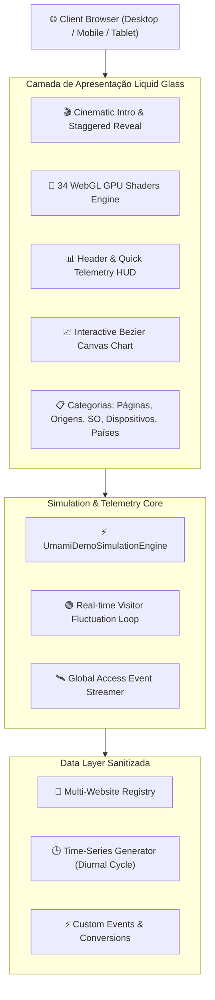

# Umami Analytics // Portfolio Demo Edition
### 🚀 Enterprise Web Telemetry, Privacy-First Architecture & Liquid Glass Experience

[](https://umami-demo-ten.vercel.app)
[](LICENSE)
[](https://webgl.org)
[](https://github.com/MateusCelestinoProX)

Uma suíte demonstrativa e interativa de análise de tráfego web, telemetria de alta frequência e privacidade de ponta a ponta, encapsulada em um **Design System proprietário VisionOS / Liquid Glass** com aceleração gráfica WebGL em tempo real.

---

## 🌟 Destaques do Projeto

- **Cinematic Boot & Staggered Reveal:** Sequência de inicialização suave com checklist de subsistemas e transição em cascata para os cards e painéis analíticos.
- **Client-Side Live Simulation Engine:** Motor autônomo de telemetria hiper-realista que simula flutuações de visitantes ao vivo, streaming contínuo de acessos globais e recálculo dinâmico de séries temporais.
- **Glassmorphism de Alta Precisão:** Estética translúcida de vidro neutro com suporte a 34 shaders WebGL em GPU (Strands Luminosos, Plasma Wave, Side Rays, Soft Aurora, Ferrofluid, Volumetric Beams, etc.).
- **Multi-Tenant Website Switcher:** Alternância instantânea entre múltiplas plataformas simuladas (*Nexus AI Platform*, *MCP Liquid Glass OS*, *Quantum Commerce Engine*), com re-renderização de métricas e gráficos.
- **Zero-Exposure & Privacy-Preserved:** Ambiente blindado e sanitizado com substituição total de dados proprietários por instâncias demonstrativas de alto impacto para portfólio.
- **Zero Dependência Externa:** 100% autocontido no navegador do cliente, sem atrito de bancos de dados ou risco de falhas de conexão durante apresentações para recrutadores e clientes.

---

## 🏗️ Arquitetura do Sistema



---

## 🕹️ Funcionalidades Demonstradas

1. **Visão Geral e Métricas Principais (Hero Cards):**
   - Visualizações de Páginas com sparklines dinâmicos.
   - Visitantes Únicos, Sessões, Taxa de Rejeição e Duração Média da Visita.
   - Filtros de período temporal: *Hoje*, *24h*, *7 Dias*, *30 Dias*, *90 Dias*, *1 Ano*.

2. **Gráfico Interativo de Tráfego:**
   - Curvas Bezier suaves sobrepostas com gradientes translúcidos.
   - Amostragem em alta resolução com ferramenta de tooltip sob demanda no cursor.

3. **Breakdown Analítico Completo:**
   - **Páginas:** URLs mais acessadas, páginas de entrada e páginas de saída com barra proporcional de preenchimento.
   - **Origens / Referrers:** Mecanismos de busca, mídias sociais, campanhas UTM e tráfego direto.
   - **Plataformas & Hardware:** Navegadores (Chrome, Safari, Firefox...), Sistemas Operacionais (macOS, Linux, Windows, iOS, Android) e Dispositivos.
   - **Geolocalização Global:** Distribuição geográfica internacional com bandeiras em alta fidelidade.
   - **Eventos Personalizados:** Monitoramento de taxas de conversão (`checkout_subscription`, `api_token_created`, etc.).

4. **Atividade em Tempo Real:**
   - Radar global de conexões ativas.
   - Feed contínuo de eventos inseridos em streaming a cada 3 segundos com animações suaves de transição.

---

## 🚀 Execução Local Rápida

Como a demo é 100% autocontida e client-side, execute com qualquer servidor HTTP:

```bash
# Clone o repositório
git clone https://github.com/MateusCelestinoProX/umami-demo.git
cd umami-demo

# Usando Python
python3 -m http.server 3000

# Ou usando Node / npx serve
npx serve .
```

Acesse: `http://localhost:3000`

---

## ☁️ Deploy Imediato na Vercel

O projeto possui configuração nativa em `vercel.json` com políticas de segurança HTTP e cache otimizado:

```bash
vercel --prod
```

---

## 👤 Autor & Engenharia

Desenvolvido por **Mateus Celestino**  
GitHub: [@MateusCelestinoProX](https://github.com/MateusCelestinoProX)  
Email: [202405039459@alunos.estacio.br](mailto:202405039459@alunos.estacio.br)
